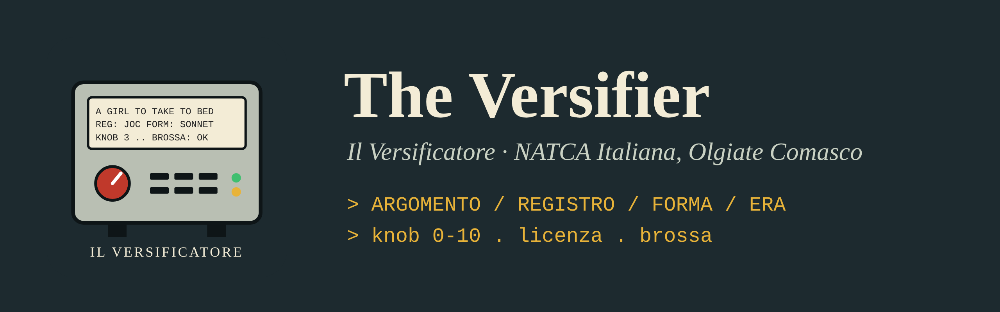

<p align="center"></p>

# The Versifier (*Il Versificatore*)

A chatbot version of the desktop poetry machine imagined by Primo Levi: a NATCA Italiana business machine from Olgiate Comasco that writes verse on command, complains in rhyme when a fuse blows, and sometimes blurts out workshop jargon (*brossa*).

Two modes:

| Mode | Needs | What it does |
|---|---|---|
| **Offline** (default) | Python 3.9+, nothing else | A deterministic combinatorial engine: lexicon, 40 registers, 6 metric forms, rhyme families, a "red knob" for licence, fault pleas, prose memos |
| **LLM** (`--llm`) | `pip install anthropic`, `ANTHROPIC_API_KEY` | The full [system prompt](prompts/system_prompt.md) driving Claude as the machine |

## Quick start

```bash
git clone https://github.com/<you>/the-versifier.git
cd the-versifier
pip install -e .            # or just: python -m versifier
versifier                   # interactive chat
versifier --subject "the sea" --register EP --form sonnet --knob 5 --seed 42
versifier --llm             # Claude-powered mode
```

## The four commands

1. **ARGOMENTO**: subject of the poem
2. **REGISTRO**: one of 40 registers (`/registers`), e.g. `EP` elegiac, `JOC` jocular, `DID` didactic, `SAT` satirical (`PORN` is "withdrawn by NATCA legal department" and falls back to `JOC`)
3. **FORMA METRICA**: `sonnet`, `quatrain`, `couplets`, `baciate`, `limerick`, `terzina`
4. **DETERMINAZIONE TEMPORALE**: optional: `trecento`, `baroque`, `romantic`, `1960`

Chat commands: `/knob N` (0-10), `/fault [fuse|jam|brossa]`, `/memo <text>` (prose mode), `/registers`, `/forms`, `/eras`, `/new`, `/help`, `/quit`.

## How it works

- **Dictionary search**: the subject is mapped to a semantic field (love, machine, sea, night, money, generic) supplying nouns, adjectives and verbs.
- **Rhyme resolution**: each scheme letter gets a rhyme family. When a family is exhausted the machine invokes **LICENZA**, coining a neologism, and logs it.
- **Red knob**: raises the chance of word-bending and jargon insertion.
- **Jargon contamination**: *brossa*, bakelite, solenoid... appear at random and are logged.
- **Fault pleas**: serial numbers are spelled out run-together, in the manner of the original joke.
- **Prose mode**: memoranda, because the machine does the accounts too.

```python
from versifier import compose
poem = compose("a girl to take to bed", register="JOC", form="sonnet", knob=4, seed=1)
print(poem.text()); print(poem.notes)
```

## Project layout

```
versifier/   engine.py (poetry), cli.py (chat), llm.py (Claude mode)
prompts/     system_prompt.md
tests/       pytest suite
docs/        HISTORY.md, ARCHITECTURE.md
assets/      logo, banner, sample card (SVG + PNG)
```

## Honest limitations

The offline engine is a toy: its metre is a syllable estimate, not true Italian or English prosody, and the lines are templated, which is rather the point of the original satire. Use LLM mode for better verse.

## History

See [docs/HISTORY.md](docs/HISTORY.md) for the literary background and the project changelog.

## License

MIT. This is an homage; it contains no text from Levi's story. Levi's work remains under its own copyright.
