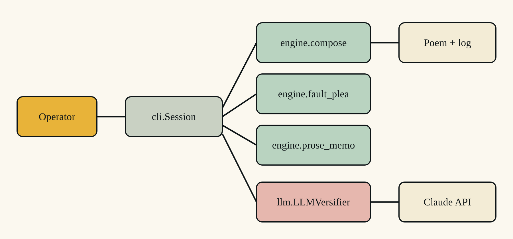

# Architecture



```
operator -> cli.Session (4-stage input state machine)
              |-- offline: engine.compose() -> Poem(lines, notes)
              |-- /fault : engine.fault_plea()
              |-- /memo  : engine.prose_memo()
              '-- --llm  : llm.LLMVersifier (system_prompt.md + Claude API)
```

**engine.compose** steps: pick semantic field -> assign a rhyme family per scheme letter -> for each line choose the rhyme word (or coin one under LICENZA), generate 12 template candidates, keep the one closest to the target syllable count -> apply era substitutions -> return the poem with a log of licence and jargon events.

Extending: add registers in `REGISTERS`, forms in `FORMS`, templates in `TEMPLATES`, semantic fields in `FIELDS`, rhyme families in `RHYME_FAMILIES`.
